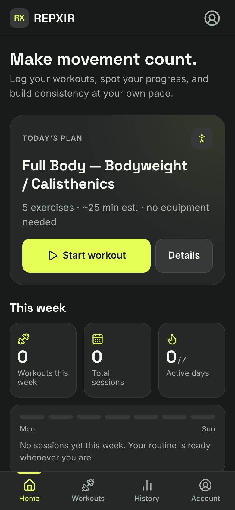
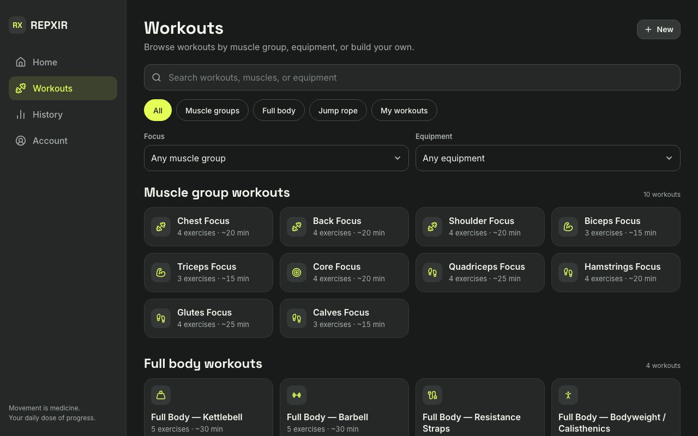

# REPXIR app

**Movement is medicine. Your daily dose of progress.**

The REPXIR workout tracker: a mobile-first, local-first React single-page app. Browse 15 built-in workouts, build your own, log strength sets and jump-rope rounds, and review your history. No account; all data stays in the browser.

<p>
  
  
</p>

Product spec: [`../design.md`](../design.md) · Brand: [`../REPXIR_Brand_Guide.md`](../REPXIR_Brand_Guide.md) · Wireframes: [`../Resources/REPXIR-wireframe.png`](../Resources/REPXIR-wireframe.png)

## Getting started

Requires Node 20.19+ or 22.12+.

```bash
npm install
npm run dev          # http://localhost:5173
```

| Script | What it does |
|---|---|
| `npm run dev` | Vite dev server with hot reload |
| `npm run build` | Production build to `dist/` |
| `npm run preview` | Serve the production build locally |
| `npm run lint` | oxlint |
| `npm test` | Vitest unit and component tests |
| `npm run test:e2e` | Playwright journeys on phone and desktop viewports (builds and serves the app on port 4173) |
| `npm run test:all` | Lint, unit, then end-to-end |
| `npm run pwa-assets` | Re-render app icons, `favicon.ico`, and install screenshots from `public/favicon.svg` and a fresh build |

First time running end-to-end tests: `npx playwright install chromium`.

## Screens and routes

| Route | Screen |
|---|---|
| `/` | Home: today's plan, this week's stats, recent and prebuilt workouts |
| `/workouts` | Library: search, category chips, focus and equipment filters (state kept in the URL) |
| `/workouts/:id` | Workout detail: exercises with how-to text, equipment, notes, Start, Duplicate/Edit; jump-rope target setup |
| `/builder/new`, `/builder/new?from=:id`, `/builder/:id` | Create, duplicate, or edit a custom workout |
| `/session` | Active session: set logging, timers, rest, pause/resume, skip, finish/discard; jump-rope tracker |
| `/history`, `/history/:id` | Completed sessions and session summaries (notes editable, delete with confirmation) |
| `/account` | Display name, stats, units (lb/kg), export/import/delete data, about |

Navigation follows the wireframes: **Home · Workouts · History · Account** as bottom tabs on phones and a left rail at 1024px and wider. An in-progress workout shows a "Return" bar instead of an extra tab.

## Architecture

```text
src/
├── data/          exercises.js (54 exercises), templates.js (15 templates), taxonomy.js
├── services/      sessionService.js  pure session state machine (start → pause/resume → finish)
│                  workoutService.js  lookup, search/filter, duplicate, duration estimate
│                  storage.js         IndexedDB + localStorage persistence
│                  backupService.js   JSON export, validated import, merge
│                  prefs.js           units and display name
├── store/         StoreProvider (app data + actions), toast + confirm providers, hooks.js
├── pages/         one file per route; session/ and builder/ hold their sub-components
├── components/    AppShell, Dialog, cards, icons, empty states
├── utils/         validators, summaries, units, formatting, stats
└── styles/        tokens.css (brand guide §17), base, layout, components, screens
```

### Key rules (from `design.md`)

- **Snapshots:** starting a workout deep-clones the template. Editing or deleting a workout never changes past sessions.
- **Only completed sets count.** Drafts and prefilled values are never included in totals.
- **One active session.** Starting another prompts *Resume / Discard & start new / Cancel*.
- **Timers** use `performance.now()` while running. After a reload the draft comes back **paused**, so time spent away isn't counted. A running session is also saved every 15 seconds and whenever the page is hidden.
- **Jump rope** records actual jumps and actual work time separately from the targets. Pace appears only when work time exists, and jumps are never inferred from time.
- **Units:** loads are stored in kilograms and converted only for display.

### Storage

| Data | Where | Why |
|---|---|---|
| Custom workouts, completed sessions | IndexedDB (`repxir` database) | Durable, structured, larger capacity |
| In-progress session draft | localStorage (`repxir:activeSession`), falling back to IndexedDB if localStorage is blocked | Synchronous writes survive an instant reload or tab close |
| Preferences | localStorage (`repxir:prefs`) | Small and synchronous |

If IndexedDB is unavailable (some private modes), the app runs from memory and shows a warning to export before leaving.

## Install and offline (PWA)

[vite-plugin-pwa](https://vite-pwa-org.netlify.app/) generates `manifest.webmanifest` and a Workbox service worker at build time (config in `vite.config.js`).

- **Offline after the first visit:** the JS, CSS, `index.html`, icons, and Latin font files are precached. Every navigation falls back to the cached `index.html`, so deep links like `/workouts/system-chest` load offline, matching the `vercel.json` rewrite online. Other font subsets are cached the first time they're used.
- **Installable on phone and desktop:** name REPXIR, short name RX, `#191B1B` theme and background. Icons: 192/512 PNG, a maskable 512, an Apple touch icon, the SVG favicon, and a `favicon.ico` fallback. Narrow and wide screenshots enable the richer install dialog on Android and desktop Chrome/Edge, and shortcuts (Workouts, Build a workout, History) appear when you long-press or right-click the installed icon.
- **Updates:** a new deploy installs in the background and shows a small "A new version of REPXIR is ready · Reload" prompt (above the tab bar on phones, bottom-right on desktop). It never reloads on its own and stays hidden while a workout is in progress. The open app checks for new deploys hourly.
- The service worker only runs in production builds (`npm run build && npm run preview`), not in `npm run dev`.

## Deploying to Vercel

`vercel.json` sets the Vite build, rewrites every route to `index.html` (so deep links and refreshes work), sets long-term caching for hashed assets, serves `sw.js` with `no-cache` so updates are found quickly, and adds basic security headers.

The app lives in this `repxir/` subfolder, so set the Vercel project's **Root Directory** to `repxir`. If you deploy from inside this folder with the CLI (`vercel`), no extra setting is needed.

## Testing

- **Unit (`tests/unit`)**: seed-data integrity, session state machine (snapshot isolation, count-once, pause/resume, reload-as-paused), jump-rope totals (90 + 100 + 110 = 300, pace unavailable without time), validators, units, backup validation and merge, IndexedDB storage, and routing/component behavior.
- **End-to-end (`tests/e2e`)**: all three journeys from `design.md` §6, resume after reload, second-workout conflict, every built-in workout's detail page, deep links and back/forward, empty and not-found states, no horizontal overflow, units switching, export → delete all → import, offline reload of deep links via the service worker, and the install manifest. Every test fails on any console error.

## Not yet included

- Charts and trend graphs beyond the summary stats
- Custom exercises outside the built-in catalog
- Cloud sync and accounts (out of scope for v1 by design)
