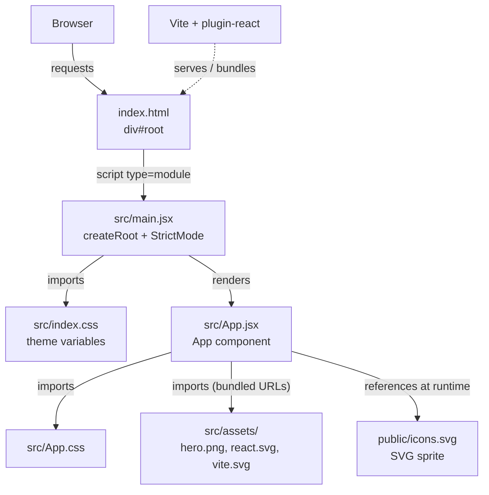
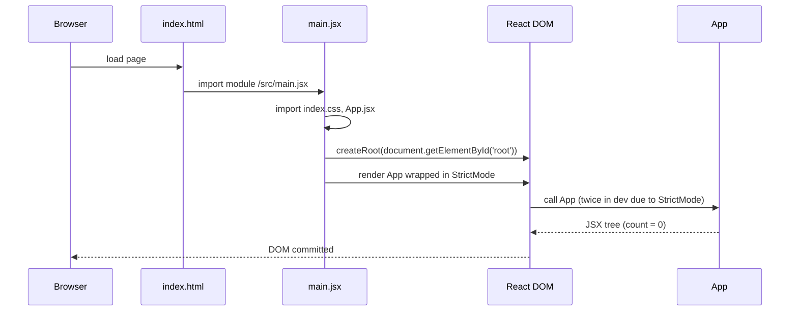

# Architecture Overview

<!-- ATLAS:BEGIN generated -->
## Summary
repxir is a client-only React single-page application (SPA). There is no server code, no API layer, and no persistence. Everything runs in the browser: Vite serves (dev) or bundles (build) the code, `index.html` loads `src/main.jsx`, which mounts the `App` component into `
`.

## Layers present
| Layer | Exists? | Where |
|---|---|---|
| Presentation | Yes | [[App Component]], [[Styling and Theming]] |
| Application bootstrap | Yes | [[main.jsx Entry Point]], `index.html` |
| State | Yes, minimal | Local `useState` in App — see [[State Management]] |
| Routing | No (dependency installed only) | see [[Technical Debt]] |
| Service / API / data access / persistence / auth | No | — |
| Build tooling | Yes | `vite.config.js` — see [[Development Setup]] |

## System diagram (verified)

Solid arrows are static imports or HTML references verified in source. The dashed arrow is the tooling relationship.

## Entry points
| Entry | Role |
|---|---|
| `index.html` | HTML shell; declares `#root`, favicon `/favicon.svg`, title "repxir", loads `/src/main.jsx` as an ES module |
| `src/main.jsx` | JavaScript entry; mounts React. See [[main.jsx Entry Point]] |
| `vite.config.js` | Tooling entry; registers `@vitejs/plugin-react` |
| npm scripts | `dev`, `build`, `lint`, `preview` — see [[Development Setup]] |

## Boot sequence

## Boundaries
- **First-party:** `index.html`, `src/`, `public/`, `vite.config.js`, `.oxlintrc.json`, `package.json`.
- **Third-party:** `node_modules/` (summarized in [[Dependency Overview]]).
- **Excluded from mapping:** `node_modules/`, `dist/` (not present), `.agents/` and `.claude/skills/` (installed AI-agent skills tracked by `skills-lock.json`; not application code).

## Related
- [[File Inventory]] · [[Component Map]] · [[Starter Counter]] · [[State Management]]
<!-- ATLAS:END generated -->
