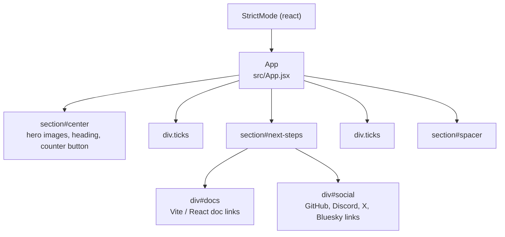

# Component Map

<!-- ATLAS:BEGIN generated -->
The project has exactly one first-party React component and no other first-party functions, so this note also serves as the Module Map and Function Index.

## Component tree (verified)

All children below `App` are plain HTML elements, not components.

## Modules
| Module | Path | Kind | Exports | Note |
|---|---|---|---|---|
| Entry | `src/main.jsx` | Side-effect module | none | [[main.jsx Entry Point]] |
| App | `src/App.jsx` | Component | `default App` | [[App Component]] |
| Styles | `src/index.css`, `src/App.css` | CSS | — | [[Styling and Theming]] |

## Function index
| Function | Location | Purpose | Note |
|---|---|---|---|
| `App()` | `src/App.jsx` | Renders the whole page; owns `count` state | [[App Component]] |
| inline `onClick` handler | `src/App.jsx`, counter button | Increments `count` with a functional update | [[Starter Counter]] |

## Related
- [[Architecture Overview]] · [[State Management]]
<!-- ATLAS:END generated -->
