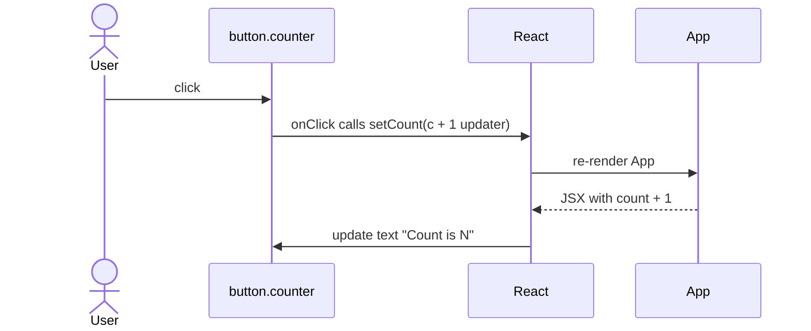

# Starter Counter

<!-- ATLAS:BEGIN generated -->
## Overview
A button that shows "Count is N" and adds 1 each time you click it. It comes from the Vite template and exists to show that React state and hot module replacement (HMR) work. It is the only interactive feature in the app.

## User experience
Clicking the button increments the number immediately. Reloading the page resets it to 0 because nothing is saved.

## Entry points and files
- Button element: `<button type="button" className="counter">` in `src/App.jsx` ([[App Component]])
- Styles: `.counter` in `src/App.css` and `src/index.css` ([[Styling and Theming]])

## State
| Kind | Detail |
|---|---|
| Local | `count`, `useState(0)` in `App` |
| Shared | none |
| Persistent | none (no localStorage, no API) |

## Execution flow
1. User clicks the button; React calls the inline `onClick` handler.
2. Handler calls `setCount((count) => count + 1)`, a **functional update** that computes from the latest queued value. That makes it correct even if several updates are batched together.
3. React schedules a re-render of `App`.
4. `App()` runs again, `useState` returns the new `count`, and the JSX returns `Count is {count}` with the new value.
5. React diffs and updates only the button's text node in the DOM.

## Error handling
None needed. No I/O, no failure paths.

## API / data storage
None.

## Tests
None.

## Known limitations
- State is lost on a full page reload. When you edit `App.jsx`, React Fast Refresh usually keeps it, but it resets if the edit changes the hooks.
- Placeholder template content. Likely to be removed.

## Modification guide
- Change the step or initial value: edit `useState(0)` and the updater in `src/App.jsx`.
- Persist across reloads: add a `useEffect` that writes to `localStorage` and initialize state from it.
- Share across components: lift state up or use React Context.

## Related
- [[React State with useState]] · [[State Management]] · [[App Component]]
<!-- ATLAS:END generated -->
