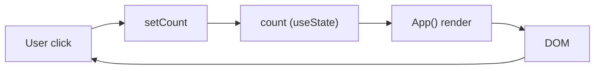

# State Management and Data Flow

<!-- ATLAS:BEGIN generated -->
## Current state inventory
| State | Owner | Type | Scope | Persistence | Written by |
|---|---|---|---|---|---|
| `count` | [[App Component]] | number | component-local | none | counter button ([[Starter Counter]]) |

That is the only application state. No Context, no reducer, no external store (Redux, Zustand, etc.), no URL state (the router is not mounted), no `localStorage`, no network data.

## Data flow
All data is either hard-coded in JSX (text, external URLs) or a static asset URL from `src/assets/` and `public/`. Data flows one way: state goes into `App`, which renders JSX, and React commits it to the DOM. User clicks feed back into state.

## Where future state is likely to go (Inferred)
- URL/route state once React Router is wired in: see [[Client-Side Routing with React Router]].
- No database or API exists, so any server data layer would be new.

## Related
- [[React State with useState]] · [[Architecture Overview]]
<!-- ATLAS:END generated -->
