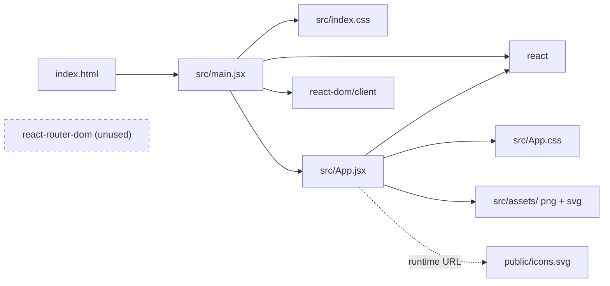

# Dependency Overview

<!-- ATLAS:BEGIN generated -->
## External dependencies
Versions were read from `package.json` (declared) and `node_modules/*/package.json` (installed) on 2026-10-14.

### Runtime (`dependencies`)
| Package | Declared | Installed | Role | Used in source? |
|---|---|---|---|---|
| `react` | ^19.2.8 | 19.3.1 | UI library: components, hooks, `StrictMode` | Yes: `main.jsx`, `App.jsx` |
| `react-dom` | ^19.2.8 | 19.3.1 | Browser renderer (`createRoot`) | Yes: `main.jsx` |
| `react-router-dom` | ^7.18.4 | 7.18.4 | Client-side routing (re-exports `react-router` 7.18.4) | **No: no imports anywhere in `src/`** |

### Development (`devDependencies`)
| Package | Declared | Installed | Role |
|---|---|---|---|
| `vite` | ^8.3.0 | 8.3.4 | Dev server with HMR, production bundler (Rolldown-based; `rolldown` is installed) |
| `@vitejs/plugin-react` | ^6.1.1 | 6.1.2 | JSX transform and React Fast Refresh in Vite |
| `oxlint` | ^1.81.0 | 1.88.0 | Linter (`npm run lint`) |
| `@types/react`, `@types/react-dom` | ^19.2.x | — | Type definitions. The project is JavaScript, so these mainly help editor IntelliSense |

## Internal dependencies

`react-router-dom` is drawn unconnected on purpose: nothing imports it.

## Hot spots
- `src/App.jsx` is the only component and holds all UI. Every visible change goes through it.
- `index.html` -> `main.jsx` -> `#root` is a hard-coded contract. Renaming any of them breaks boot.

## Related
- [[Development Setup]] · [[Technical Debt]] · [[Architecture Overview]]
<!-- ATLAS:END generated -->
